# Circulatory Fidelity × Phext

An optional, additive integration: it stores CF diagnostics in
[phext](https://phext.io) form, so the precision decomposition
Λ = D + R stops being a matrix you parse and becomes an address space
you query. D (diagonal, retained by MFVI) and R (off-diagonal,
discarded by MFVI) live in separate phext lanes; any single relational
entry, verdict, or dataset field is one coordinate lookup.

It changes nothing about CF itself: no upstream files are modified,
and the only dependency is numpy (already a CF dependency). The phext
reader/writer is pure standard library.

## What phext enables for Circulatory Fidelity, in 90 seconds

**Before.** A `diagnose()` result is an ephemeral dataclass. A
coupling matrix is an in-memory array. The validation evidence is
flat CSV rows, where *which* pair, layer, or window a number belongs
to is only a value in a column. Every question — "what was the
verdict?", "which window was worst?", "where does mse_ratio cross
2?" — means loading and re-parsing a whole array or file, then
filtering it back down to the one number you wanted.

**The move.** CF already splits Λ = D + R *by position*: D lives on
the diagonal, R off it. Phext gives position an **address** — a 9-D
coordinate `Library.Shelf.Series/Collection.Volume.Book/Chapter.Section.Scroll`,
with each field of each record as its own scroll at its own
coordinate, and the coordinate map itself stored inside the file as
a manifest scroll at `1.1.1/1.1.1/1.1.1`. Volume = one run, matrix,
windowed result, or dataset; Book = the lane (see the diagram
below).

**What that enables, concretely:**

1. **Fetch one relational entry without parsing a matrix.** D sits
   in Book 3, R in Book 4. The largest |R| entry of the demo matrix
   is at `1.1.1/1.1.4/2.4.1` — Volume 1, Book 4 (R lane),
   Chapter 2 (i = 1), Section 4 (j = 3), Scroll 1 (the value field).
   One coordinate lookup returns R[1,3]; "the part MFVI discards"
   is a place you can point at, not a computation you re-run.
2. **The verdict lives at a fixed address.** The demo diagnosis
   (IC = 0.8029 ± 0.0224) stores its recommendation at
   `1.1.1/1.1.2/1.1.6` — Book 2, Scroll 6. Any tool can read the
   verdict without importing the module or re-running the samples.
3. **The Maximal Coupling Rule becomes an address, not a search.**
   Each windowed-IC window gets its own coordinate in Book 5, and
   the verdict scroll records which one holds IC_max. In the demo
   that is `1.1.1/1.2.5/41.1.1`: Volume 2, Book 5, Chapter 41
   (window 40), Scroll 1 — IC = 0.9206, named rather than scanned for.
4. **Validation CSVs become queryable volumes — and still round-trip.**
   All 8 `simulations/*.csv` files import as dataset volumes
   (Book 6, one verbatim scroll per field; e.g. one SVF replicate's
   mse_ratio is the single scroll at `1.1.1/1.5.6/1202.1.5`), and
   export reproduces every file **byte-for-byte**, quoted
   comma-containing fields included.
5. **The file describes itself, and standard phext tooling reads it.**
   The manifest at `1.1.1/1.1.1/1.1.1` carries the whole coordinate
   map, the file is plain text (valid UTF-8 as a whole), and SQ can
   host it for `sq select <coordinate>` queries. No new
   dependencies: the module is standard library + numpy.

**What it does not change.** No CF math, no CF API, no upstream
files. Phext is storage and addressing only — CF's numbers go in,
the same numbers come out, now with addresses.

**Marginal vs conditional coupling (schema 2).** A matrix entry's
value and its correlation are different kinds of statement, and
schema 2 stores both, labelled. In a chain A–B–C with correlations
0.6, 0.6, the marginal corr(A, C) is 0.36 — but Λ_AC = 0, so A and C
are conditionally independent given B (partial correlation 0). Each
entry record therefore carries `ic_marginal` (field 2, the quantity
schema 1 always stored, and the marginal pairwise IC CF defines)
alongside `ic_conditional` / signed `partial_corr` (fields 7–8,
partial_ij = −Λ_ij/√(Λ_ii·Λ_jj)) and the signed `marginal_corr`
(field 9). `coupling_from_phext(path, volume, i, j)` reads both —
including from schema 1 files, where the conditional values are
derived from the stored matrix and the signed marginal is honestly
reported as not stored. Neither quantity is causation; whether
conditional IC should become a CF diagnostic proper is Aaron's
call, not this integration's (see INTEGRATION.md §8).

### The enhancement, as a diagram

```mermaid
%%{init: {"theme": "base", "themeVariables": {"fontFamily": "ui-sans-serif, system-ui, sans-serif", "lineColor": "#718096"}}}%%
flowchart TB
    subgraph IN["✦ &nbsp;BEFORE — ephemeral objects &amp; flat files"]
        direction LR
        A(["🧪 Samples<br/><b>diagnose(x, y)</b><br/><i>an object, then gone</i>"])
        B(["🔢 Precision matrix<br/><b>Λ = D + R</b><br/><i>an array in memory</i>"])
        C(["🗂️ simulations/*.csv<br/><b>8 validation files</b><br/><i>identity = a column value</i>"])
    end

    F{{"⚙️ &nbsp;<b>cf_phext.py</b><br/>stdlib + numpy · zero new dependencies<br/><i>CF splits by position → phext gives position an address</i>"}}

    subgraph P["📜 &nbsp;ONE SELF-DESCRIBING .phext &nbsp;·&nbsp; Volume = one run / dataset"]
        direction TB
        L1["<b>Book 1 · Manifest</b><br/>the coordinate map, inside the file<br/>📍 1.1.1/1.1.1/1.1.1"]
        L2["<b>Book 2 · Summary + Verdict</b><br/>📍 verdict at 1.1.1/1.1.2/1.1.6<br/><i>IC = 0.8029 → Structured inference required</i>"]
        L3["<b>Book 3 · D — nodal</b> 🌱<br/>diagonal · <i>retained by MFVI</i>"]
        L4["<b>Book 4 · R — relational</b> 🔥<br/>off-diagonal · <i>discarded by MFVI</i><br/>📍 largest |R| at 1.1.1/1.1.4/2.4.1"]
        L5["<b>Book 5 · Windowed</b><br/>📍 IC<sub>max</sub> = 0.9206 lives at 1.1.1/1.2.5/41.1.1<br/><i>the Maximal Coupling Rule, as an address</i>"]
        L6["<b>Book 6 · Datasets</b><br/>8 CSV volumes · one scroll per field"]
        L7["<b>Book 7 · Provenance</b><br/>upstream version · source · timestamp"]
        L1 ~~~ L2 ~~~ L3 ~~~ L4 ~~~ L5 ~~~ L6 ~~~ L7
    end

    subgraph OUT["✦ &nbsp;AFTER — every answer has an address"]
        direction LR
        Q(["🎯 <b>Coordinate query</b><br/>one entry, no matrix parse"])
        S(["🌐 <b>SQ hosting</b><br/>sq select by coordinate"])
        E(["♻️ <b>CSV export</b><br/>byte-exact round-trip"])
    end

    IN ==> F ==> P ==> OUT

    classDef input fill:#EBF4FF,stroke:#3182CE,stroke-width:1.5px,color:#1A365D;
    classDef engine fill:#FAF5FF,stroke:#805AD5,stroke-width:2.5px,color:#322659;
    classDef lane fill:#FFFFFF,stroke:#A0AEC0,stroke-width:1px,color:#1A202C;
    classDef dLane fill:#F0FFF4,stroke:#38A169,stroke-width:2px,color:#22543D;
    classDef rLane fill:#FFF5F5,stroke:#E53E3E,stroke-width:2px,color:#742A2A;
    classDef verdict fill:#FFFFF0,stroke:#D69E2E,stroke-width:2px,color:#744210;
    classDef manifest fill:#EBF8FF,stroke:#3182CE,stroke-width:2px,color:#2A4365;
    classDef output fill:#FFF5EB,stroke:#DD6B20,stroke-width:1.5px,color:#7B341E;

    class A,B,C input;
    class F engine;
    class L1 manifest;
    class L2 verdict;
    class L3 dLane;
    class L4 rLane;
    class L5,L6,L7 lane;
    class Q,S,E output;

    style IN fill:#F7FAFC,stroke:#CBD5E0,stroke-dasharray:6 4
    style P fill:#FFFBEB,stroke:#D69E2E,stroke-width:2px
    style OUT fill:#FFF5EB,stroke:#ED8936,stroke-dasharray:6 4

    linkStyle default stroke:#718096,stroke-width:2px
```



One phext, read as a coordinate map:

```text
Coordinate = Library.Shelf.Series / Collection.Volume.Book / Chapter.Section.Scroll

Volume 1 = one diagnostic run (Volume increments per run / matrix / dataset)
  Book 1  Manifest          1.1.1/1.1.1/1.1.1   the coordinate map, inside the file
  Book 2  Summary + verdict 1.1.1/1.1.2/1.1.6   the recommendation scroll
  Book 3  D - nodal (diagonal, retained by MFVI)
  Book 4  R - relational (off-diagonal, discarded by MFVI)
  Book 5  Windowed series   (one Chapter per window)
  Book 6  Dataset rows      (one Chapter per row, one Scroll per field)
  Book 7  Provenance        (upstream version, timestamp, source)

Reading one address - 1.1.1/1.1.4/2.4.1:
  1.1.1   Library . Shelf . Series        fixed for study phexts
  1.1.4   Collection . Volume 1 . Book 4  -> the R lane
  2.4.1   Chapter 2 . Section 4 . Scroll 1
          Chapter = i+1 (i = 1), Section = j+1 (j = 3), Scroll 1 = value field
  => the value of R[1,3] - fetched alone, no matrix parse
```

## Quickstart

```python
import numpy as np
import cf_phext as px

# (1) Diagnose a pair, store the verdict in a phext, read it back
#     by coordinate alone.
rng = np.random.default_rng(20261101)
x = rng.standard_normal(2000)
y = 0.8 * x + 0.6 * rng.standard_normal(2000)
info = px.diagnose_to_phext(x, y, "run.phext", model_type="filtering")
print(px.read_scroll("run.phext", info["verdict_coord"]))
# -> Structured inference required (very strong coupling)   (IC = 0.803)

# (2) Decompose a precision matrix into addressed D and R lanes.
A = rng.standard_normal((4, 4)); M = A @ A.T + 4 * np.eye(4)
vol = px.matrix_to_phext(M, "matrix.phext", kind="precision")
assert np.max(np.abs(px.matrix_from_phext("matrix.phext", vol) - M)) < 1e-12

# (3) Import a simulation CSV field-verbatim; export is byte-exact.
vol = px.import_csv_to_phext("simulations/svf_validation.csv", "data.phext")
assert px.export_phext_to_csv("data.phext", vol) == \
    open("simulations/svf_validation.csv").read()
```

## What the demo proves (seeded, reproducible)

Running `python3 demo.py` in this integration:

- diagnose on a synthetic pair built with ρ = 0.8 returns
  IC = 0.8029 ± 0.0224 (n = 2000), verdict stored at
  `1.1.1/1.1.2/1.1.6` and read back from that coordinate alone.
- A 4×4 precision matrix round-trips through the D/R lanes with
  reconstruction error 0.0 (test tolerance: 1e-12 on a random 6×6 SPD
  matrix). The largest |R| entry is directly addressed, e.g.
  `1.1.1/1.1.4/2.4.1`.
- A windowed series with a planted high-coupling regime yields
  IC_max = 0.9206, and the verdict scroll records the exact window
  coordinate holding it (`1.1.1/1.2.5/41.1.1`) — the Maximal Coupling
  Rule as an address, not a search.
- All 8 `simulations/*.csv` files (33,965 data rows) import into one
  phext and export back **byte-for-byte**, including quoted fields
  containing commas (`ic_bin` in `threshold_calibration.csv`).
- Worked query on the imported data, by coordinate alone: in
  `svf_validation.csv`, mean mse_ratio by coupling level rises from
  1.000 at coupling 0 to 9.65 at coupling 2.0, first reaching ≥ 2 at
  coupling ≈ 0.316; in `hlm_validation.csv`, the mean
  no-pool/partial-pool mse_ratio falls from 7.98 in the bottom IC
  decile to 1.01 in the top decile — filtering and pooling read the
  same axis in opposite directions (the Dependency Asymmetry).

## Julia users

The phext is plain structured text — language-neutral. Anything Julia
can write as CSV enters the same phext through the same importer, and
the upstream Julia implementation's results travel identically:

```julia
using DelimitedFiles
# A precision matrix (or any validation table) produced in Julia:
writedlm("lambda_from_julia.csv", Matrix_of_interest, ',')
```

```python
import cf_phext as px
vol = px.import_csv_to_phext("lambda_from_julia.csv", "study.phext")
```

A native Julia phext reader/writer is a natural follow-up; the format
is ~40 lines of delimiter logic (see `INTEGRATION.md` for the spec
summary and the manifest scroll embedded in every file).

## Layout

- `python/cf_phext.py` — the module (writer/reader + CF bridges + CLI)
- `python/test_cf_phext.py` — tests (parser agreement with the
  reference phext parser, D+R reconstruction, diagnose round-trip,
  CSV round-trips, UTF-8 validity, marginal vs conditional coupling,
  schema-1 backward compatibility, SQ interop)
- `python/demo.py` — the end-to-end demo
- `python/fixtures/schema1_chain.phext` — a schema-1 file written by
  cf_phext 1.0.0, kept as backward-compatibility evidence
- `verify.sh` — upstream suite + integration tests + demo (repo root)
- `INTEGRATION.md` — full design + coordinate map + schema-2 notes

## Verify

```sh
bash verify.sh   # upstream tests + integration tests + demo + hashes
```

Core path is pure Python; [SQ](https://github.com/wbic16/SQ) hosting
is an optional receipt (one test, skipped with a note if SQ is absent).

## Citation

If this integration is useful alongside CF, please cite CF itself:
Lowry, A. *Circulatory Fidelity: A Relational Theory of Information
Flow in Hierarchical Models.* DOI: 10.5281/zenodo.18121821.
Phext is by Will Bickford — see https://phext.io.
